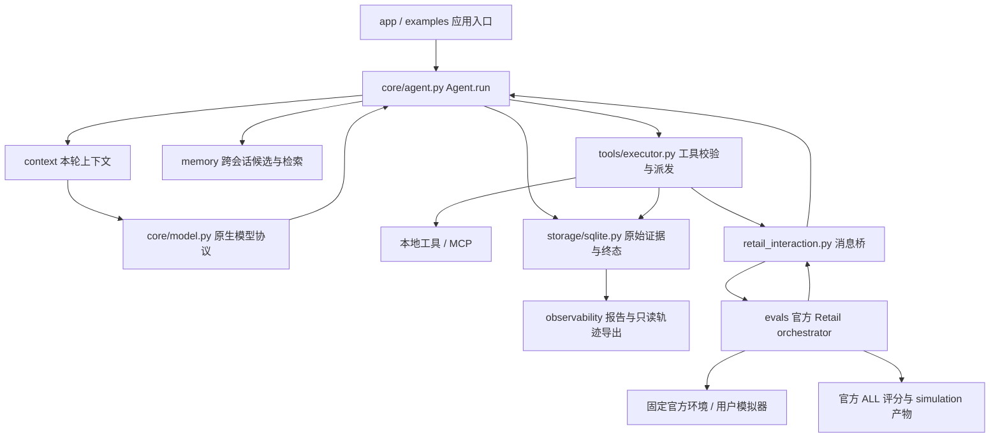

# 当前技术架构

采用轻量单 Agent、独立能力模块与程序化执行控制。模型负责语义判断，程序负责可执行约束和证据；通用核心不理解 Retail 业务或评分字段。开发约束见 [根目录 AGENTS.md](../AGENTS.md)，运行命令见 [README.md](README.md)，正式实验结论见 [run-50x3.md](experiments/retail-qwen-tier-order-20261108/run-50x3.md)。

## 架构总览

所有模块路径均相对于 `agentcore/`，评测目录 `evals/` 与该包同级。

普通入口由 Agent 调用本地/MCP 工具；Retail 入口由消息桥挂起、恢复同一个 Agent 循环，官方 orchestrator 唯一执行 Retail 工具。两条路径共享核心和证据存储。评测任务、隐藏场景、参考动作及评分条件留在 harness，不进入模型上下文。

阅读顺序建议为：`app/cli.py` → `core/agent.py` → `core/model.py` 与 `tools/executor.py` → `storage/sqlite.py`，再看 Context/Memory 和 Retail 接线。工作区目录用途及保留边界见 [外层 README](../README.md)。

## 模块与运行流程

| 模块 | 输入、输出与职责 |
| --- | --- |
| `core/agent.py`：`Agent.run` | 用户请求及用户/会话 ID → `RunResult`；唯一模型—工具循环，管理步骤、纠正上限与终态 |
| `core/model.py`：`HTTPModelClient` / `ScriptedModel` | 消息和工具定义 → `PreparedRequest` → 类型化 `ModelResponse`；适配协议，不选择业务行动 |
| `context/manager.py`：`ContextManager.prepare` | 原始历史、相关记忆、工具定义、程序状态 → 本轮实际请求与边界统计；只改变可见视图 |
| `memory/local.py`：`Memory.commit/retrieve` | 带来源的候选 → 持久化；用户与任务文本 → 相关 top-k；独立于会话和执行状态 |
| `tools/executor.py`：`ToolRegistry/ToolSpec/ToolResult` | 类型化工具调用 → 校验、执行和已知性明确的结果；可信代码决定权限与重试 |
| `storage/sqlite.py`：`Store` | SQLite 保存会话、原文、运行、工具尝试、事件、观察与记忆；提供显式恢复 |
| `observability/` | 原始记录 → 简短 `run_report` 或只读完整轨迹；不自动评分或归因 |
| `app/`、`evals/` | 应用创建模型和工具、提供角色规则；评测环境及隐藏评分材料留在 harness |

默认 CLI 的 `main → demo` 使用脚本模型；真实冒烟 `smoke.main → run_smoke → Agent.run` 复用相同核心。`_AddOnlyAgent` 仅缩小工具集合，没有第二套循环。

一次运行：

1. `Store.begin` 创建运行并保存用户原文；阻止同用户/会话的活动运行冲突。已有未知写结果时暂停，避免继续派发。
2. 每个模型步骤按当前任务 `Memory.retrieve`，由 Context 组合系统指令、运行状态、相关记忆、近期对话及历史摘要。
3. 模型适配器生成不可变 `PreparedRequest.body`；核心记录实际请求 JSON、字节数、哈希和程序生成的 model_call_id，再调用 `complete`。
4. 模型返回普通文本或原生 tool_calls。普通回答直接保存；工具调用保留 provider ID，并映射到程序生成的调用 ID。
5. 执行器先校验参数和可信前置条件，持久化派发意图，再调用本地或 MCP 工具；保存尝试结果、完整观察及工具消息，进入下一步。
6. 保存真实运行终态后返回。可选 Memory 提炼由应用另行调用，不嵌入主循环，不改变已完成运行的结果。

模型选择工具、参数、澄清和回答；不填写 revision、事务、游标或程序执行状态，也不以自报完成证明目标达成。

## 原生模型协议与配置来源

`ModelResponse` 包含 content、tool_calls、finish_reason、usage、usage_known 和 provider_metadata。核心不解释 provider 字段；服务拒绝协议时明确报错，不静默换模型、关思考或改为文本 JSON 协议。当前 HTTP 适配器只实现非流式 Chat Completions，无 SDK/HTTP 自动重试，且 `trust_env=False`、不跟随重定向。

`reasoning_content` 从服务接收后保存在 provider_metadata 和 assistant 原始消息的 `_provider_metadata`。它不是最终答案或记忆来源。Context 保留仍可见消息的元数据；唯一序列化函数 `chat_request_bytes` 决定是否回传：

- `provider="qwen"` 要求显式 thinking 布尔值；发送 enable_thinking、preserve_thinking 和 stream=False。保存思考与回传思考分别控制；普通客户端 preserve_thinking 默认 False，当前 smoke 显式 True。
- `provider="deepseek"` 发送 thinking.type。开启思考且携带工具时，适配器要求保留的 assistant 历史具备 reasoning 元数据并回传；缺失则报能力错误，不伪造空内容。这里只说明当前适配契约，不推定其他托管渠道或真实型号已验证。
- `compatible` 不自动加入 provider 思考参数。配置 max_completion_tokens 时替代 max_tokens；当前 smoke 使用 2048 总输出上限。

模型与地址由创建客户端的应用负责，核心无全局 `.env` 加载器。**当前 smoke 的真实规则：**

| 项目 | 来源和优先级 |
| --- | --- |
| model | `smoke.MODEL` 用户当前修改为 qwen3.7-flash；无模型 CLI 覆盖，不读取 AGENT_MODEL |
| base_url | `--base-url` 优先，否则从 `--env-file` 读取 AGENT_BASE_URL；源码无默认地址，缺失/空值报错，不回退到进程环境 |
| provider/思考/输出 | `make_client` 显式传入 Qwen、thinking=True、preserve_thinking=True、max_completion_tokens=2048 |
| 认证文件 | `--env-file`，默认工作目录下 `.env`；仅执行分支校验配置与未启动状态后读取 |
| 认证值 | `_load_key` 用 dotenv_values(interpolate=False) 取 DASHSCOPE_API_KEY；不回退到进程环境、不进入请求正文或轨迹 |

本次按用户要求实现实际文件的地址读取：`--check-config` 与冻结计划只筛选 AGENT_BASE_URL 的赋值行交给 dotenv，关闭插值，不解析认证值；`--execute` 冻结一致性检查后才加载密钥。显式地址覆盖时不读取配置文件的地址，只读 `--inspect` 不读配置文件。新增配置检查模式无需输出目录，不构造客户端；显示实际 URL 与来源，不发网络请求。模型仍为用户当前别名，不读取 AGENT_MODEL，不声称实现通用模型配置。现有北京地址验证与价卡约束保留，不静默替换不兼容地址。

## Context：可见输入与实际发送使用同一边界

`recent` 从最近三个用户轮开始，超界时移除低优先级记忆或更旧的完整轮次；`full` 提供完整历史基线，超界显式失败。工具调用/结果必须配对，最新用户原文和本轮工具组不截断。

新增`capacity`优先保留完整会话，只有最终序列化请求超过安全预算时才移除旧完整用户轮次；它和原`recent`独立可选。Retail当前默认capacity+legacy（B），原始A需显式选择recent+legacy；capacity+task为C。两项均只影响Agent，其他角色及官方Policy不变。

`compaction="task"`仅在实际预算压力下建立带来源的交接：完整用户引文、未验证Agent陈述、按时间排序的工具证据及原始引用。程序不推断永久授权、当前目标已完成或未知写结果；不能可靠压缩的用户原文若仍超限则停止。交接由当前会话记录纯函数生成，不新增Store表、跨任务缓存或Memory hook，不随一次Agent.run结束而丢失同任务历史。

优化模式保留字节硬上限内的2048字节余量；可另配置可信的全请求Token计数器、已核实窗口和真实输出预留。没有可信来源时只实施字节边界并明确Token未知，粗略字节Token代理不作为模型窗口保证。原A序列化不变，新增观测字段只写入Core事件。

长观察在可见视图中变成状态、短预览和 observation_ref；完整内容仍保存在 messages/observations。内部 `read_observation` 按字符分页，并检查用户与会话作用域。默认历史摘要是带来源的用户摘录和工具状态摘录，不调用模型；摘要失败回退，不覆盖原文或替代最新要求。

Context 测量的正是适配器准备的 UTF-8 请求字节，HTTP 复核后发送同一 body；工具 schema、回传 reasoning 和请求选项均计入。该限制是本地资源边界，不是服务端 tokenizer 或窗口保证。暂保留 recent/full，不引入复杂检索算法。

## Memory：候选、检索和可选提炼

`Candidate` 提供 key、content、sources、kind、action。直接 `Memory.commit` 是可信应用接口：程序验证来源存在、用户范围、类型和容量，整批原子写入；事实/偏好要求用户来源，事件可引用其他原记录。检索按英文词项和中文片段重合排序，零匹配不注入，避免每轮加载全部记忆。

候选校验不证明语义蕴含，保存 `semantic_status=candidate_unverified`。更新与删除保留审计语义；删除活跃记忆及其旧变更内容不等于删除原始对话或提炼审计。

`memory/extraction.py` 的 `MemoryExtractor` 复用 commit 的校验/写入和 retrieve：

- `extract(user_id=..., session_id=...)` 显式处理一个批次；`after_run(result, ...)` 是应用主动接入的可选 hook，默认 enabled=False。
- 开启 hook 后，仅落盘 completed 的新增用户轮达到阈值才触发；默认阈值/批次为 5，最多 20 轮，每次最多一批、一次模型调用，无自动重试或纠错。
- 模型通过原生 `propose_memory` 提出最多 8 个候选；来源限定本批用户消息 ID 和原文，另提供少量相关旧记忆。系统提示、assistant 思考、工具输出与评分材料不作为来源。
- 程序限制用户范围、重复 key、重复内容和变更许可。覆盖/删除现有项须应用传入 corrections/deletions 且具备更新的用户来源；模型 action 本身不是授权。
- `commit_extraction` 在同一事务提交候选、memory_progress 和成功批次记录。游标/记忆快照校验拒绝过期并发批次；失败不推进，有效空候选可以推进，取消继续传播。

接入顺序为先 `result = await agent.run(...)`，再单独 `await extractor.after_run(result, user_id=..., session_id=...)`。memory_batches 独立记录请求、解析响应、用量已知性和安全错误。每批真实提炼会额外产生最多一次模型调用；目前 CLI、smoke 和 Retail 未接 hook，主基线关闭。候选语义与提炼收益尚无真实实验结论。

## 工具、MCP 与错误边界

`ToolSpec` 的只读、幂等、max_attempts、precondition、query_status 和 operation_id_parameter 由可信应用配置，不能由模型或 MCP annotations 提升权限。本地与 MCP 均经 ToolRegistry，模型不需要知道接入形式。

`tools/mcp.py` 使用官方 Python SDK 1.30.0 的 stdio 连接、初始化、发现与调用；连接生命周期覆盖运行，并在创建它的任务中关闭。仓库含真实本地子进程示例与集成测试；本次文档整理未重新执行。远程 MCP 与认证未验证。

`core/errors.py` 根据阶段、类别、是否派发、结果已知性与尝试次数返回有限决定；`tools/executor.py` 是工具自动重试的唯一归属。模型纠正参数另计，与自动重试分开记录。

| 情况 | 处理 |
| --- | --- |
| 参数错误 | 派发前拒绝，具体字段反馈，核心限制纠正次数 |
| 只读临时故障 | 可信 max_attempts 内受限退避，默认一次，最多五次 |
| 已知业务失败 | returned 且 ok=False，保留原始结果，模型收到简短安全反馈 |
| 写操作结果未知 | 有可信只读 query_status 则查询，否则等待用户；不盲目重交 |
| 缺用户信息/授权 | 前置条件拒绝或 ask_user，waiting_user |
| 模型协议错误 | 保留用量和原错；仅在用量已知且纠正额度内允许核心再决策 |
| 程序/持久化错误 | 暴露并终止，不让模型修内部异常，不合成成功 |

QUERY 仍是通用可信回调，无真实业务服务。查询成功后的结果保存错误必须作为 StorageError 传播，不能误记为查询失败。同步工具在线程中执行，取消等待不保证后台/远端动作停止。

## Storage 与真实终态

runs 管生命周期；messages 保留用户、assistant、工具原文；attempts 保存各次工具尝试最新证据，events 保存变迁；observations 保存完整结果；memories/memory_changes 及提炼表独立管理长期候选。

工具派发前先提交保守意图，返回后保存已知结果，再写对话/归档。遗留意图可能发生在实际发送前或后，故记 unknown，不猜测未执行。`Store.recover` 可补齐已提交的工具结果并标记中断，必须先确认旧执行者已停止；不自动重放未知操作。SQLite 与外部服务不能形成同一事务，不保证远端恰好一次执行。

`RunResult.status` 可为 completed、waiting_user、failed、cancelled、interrupted；工具状态为 not_dispatched、returned、unknown，另有 ok；goal_status 没有评分时保持 unverified。进程退出 0 也不能代替检查运行终态。

取消保存已有证据并传播 CancelledError。归档失败、结果保存失败和最终保存失败都不能返回可靠成功；若磁盘无法写入，落盘终态无法保证，遗留 running 需要显式核查恢复。

## Observability：记录与只读重建

`run_report` 统计调用、用量已知性、重试/纠正与终态。`trajectory.reconstruct/export` 以 mode=ro、query_only 和一致读快照读取 SQLite，不恢复运行、不改库、不覆盖导出。

轨迹保留消息 ID/seq/body、事件 seq/created/body、模型请求/响应/错误、调用映射、工具尝试、观察引用及 run_end。保存的是请求 JSON、字节数/哈希和解析响应；不是原始 HTTP 字节、认证头或完整原始响应。两张表没有统一跨表时间序；旧记录缺调用关联或终态时明确标未记录，不按邻近步骤猜测，不自动归因或评分。导出含原始对话及已记录思考，应按运行数据保护。

## 受限真实冒烟与费用证据

`SmokeModel` 只服务一个新实验：固定当前模型/地址/价卡，最多两次请求，仅 add，关闭 Memory 提炼和全部重试/纠错。默认只冻结 plan；execute 必须匹配计划，独占创建数据库；inspect 只读，不 resume。

每次派发前检查停止标记、未知/遗留请求、次数、实际配置/工具、请求体≤16000 字节及字节加 1024 framing 的输入代理界。按 32000 输入、2048+10 输出 token 预留，预算足够才落盘预留及 dispatch_intent，再发送 HTTP。单次预留 0.0080464 元、两次 0.0160928 元，实验估价限额不高于 0.05 元。

价卡来自本实验冻结的 2026-11-05 北京配置：≤32k 档为每百万输入/输出 0.2/0.8 元，后续档位见 plan；不是本轮重新联网核价。返回按实际所在档位记录用量和估价；未知用量保留预留，超时、取消、协议异常、超界或存储失败阻断继续派发。字节代理、输出容差、价卡假设及账户结算都使其不能保证绝对账单上限。

真实执行证据与配置溯源见 `experiments/retail-qwen-tier-order-20261108/runs/t50x3/` 的逐 trial 轨迹。本入口仅验证最小工具往返，不是通用预算平台，也未覆盖官方用户模拟器/裁判等 Pilot 调用。

## Retail 适配边界

`evals/retail.py` 固定官方 v2.0.0、commit `989d3285ae669e49503324bdb9981bf14fccedeb`、text-v1/en/retail，校验 checkout、源码和数据哈希；官方语言加载器应用修订任务。环境工具语义与 policy 接到自己的 Agent，不使用上游 LLMAgent 循环代替核心。

任务隐藏场景、参考动作、评分字段留在 harness，不注入 Agent。现有 fixture 只做固定交互：从第一次官方工具观察获得第二次调用参数，验证环境与隔离。`evals/offline-wiring.json` 是已有接线记录，official_score=null。

`evals/retail_interaction.py` 提供官方 HalfDuplexAgent 桥：同线程私有 asyncio loop 挂起/恢复自己的 Agent.run，经过核心校验与持久化派发意图后才向官方 orchestrator 输出工具调用，由官方环境唯一执行；结果按核心调用 ID 返回。核心已经顺序执行批量工具，桥按该顺序暴露单条官方调用，不保留并行批次外观；provider ID 映射及完整模型响应仍留在 SQLite。内部 ask_user/read_observation 不冒充 Retail 环境工具。初始历史目前只支持官方开场白，其他历史显式拒绝，不静默遗漏。

build_interaction 使用官方语言/persona 指令和 UserSimulator 构造（构造不推理），不将隐藏任务传给 Agent。停止时若官方已执行工具，则先排空已知结果再关闭；模型门禁阻止排空期间发出新请求。SQLite 留存真实终态；simulation.agent_cost 保持 null，不把上游缺失费用的求和 0 当作免费调用。

run_and_score 保存原任务、call context、未评分 simulation，再运行官方 EvaluationType.ALL、strict_replay 默认 True，不删 reward_basis 组件。裁判失败传播且保留未评分产物。官方 DB 回放与沟通/NL 的脚本传输分支已离线验证；真实模拟器/裁判未运行，无 Pilot/Baseline 成绩。evals/pilot_config.py 读取用户公共/角色配置，retail_pilot.freeze 固定四角色、源码/任务哈希、价格与停止边界；真实执行前重新核对配置，再加载认证。evals/pilot_calls.py 为四角色提供同一个 fsync 调用账本与派发前预算预留；有界作用域的官方 generate 接线只替换传输，NL 采用冻结角色模型，退出恢复绑定。请求、解码后 HTTP 响应正文、解析响应、用量已知性与结算均记录；Agent 调用关联核心 run_id/model_call_id。未知用量、异常、存储失败或超界停止后续角色，保留未知预留。单进程顺序运行，不自动重试/恢复；只读 inspect 可重建遗留请求。预算为历史/显式价卡估价，字节代理不是 tokenizer，不保证绝对账单。运行命令与产物见 evals/README.md；代理仍不执行真实调用。
